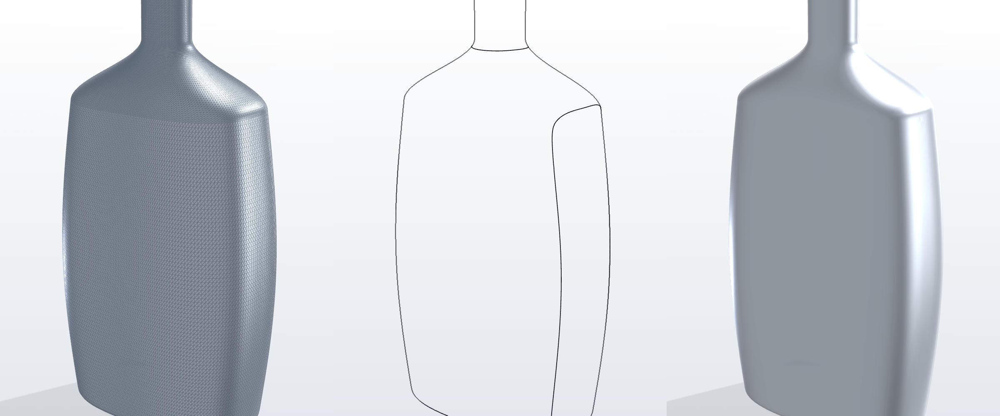
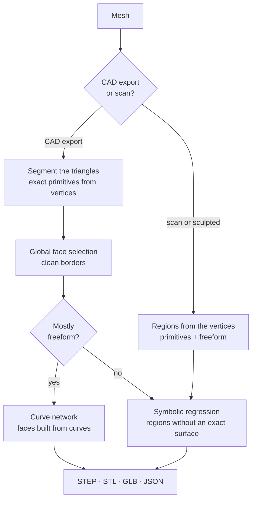

# PyCadSR

**Turn triangle meshes back into real CAD.** PyCadSR is a desktop app that reads a mesh
(STL, OBJ, PLY, OFF, GLB/GLTF, FBX) and rebuilds it as a CAD model: exact planes,
cylinders, cones, spheres and tori where the part has them, equations discovered by
symbolic regression ([PySR](https://github.com/MilesCranmer/PySR)) for the rest, and
clean trimmed B-spline faces for freeform shapes. It exports STEP.



<sub>Left: the input mesh. Middle: the face borders PyCadSR laid out, as smooth curves.
Right: the exported STEP, one trimmed B-spline surface per face.</sub>

## Why

Meshes are everywhere: CAD tools export them, scanners capture them, and many models only
exist as STL. But a mesh is thousands of unrelated triangles; you can't change a hole's
diameter or round off an edge. PyCadSR recovers the surfaces the mesh was made from, so you
get faces you can work with in any CAD tool:

- A hole is one cylinder with its exact radius, not 64 thin strips.
- A fillet is one torus or cylinder, split from the flat face it rolls into.
- A bottle is a handful of smooth surfaces with borders on its design lines, not a patchwork.

## Features

- **Exact surfaces from the mesh's own vertices.** A mesh exported from CAD has every vertex
  exactly on its true surface. PyCadSR segments the triangles directly and checks each one
  by its vertices, so faces that meet tangentially are told apart to within microns.
- **Analytic primitives**: planes, cylinders, cones, spheres and tori. Also helical sweeps
  (threads) and tubes (springs, bent wires), each as one exact surface.
- **Whole-part face selection.** One energy over the whole mesh (how well each surface fits,
  plus the length of every border) chooses all faces at once. Borders come out clean: no
  saw-teeth, no stray specks, and no patchwork of made-up surfaces on one real one.
- **Symbolic regression.** For regions with no exact primitive, PySR searches for a compact
  formula such as `r = 0.5·h + 1` or `w = 0.245·sin(2.04u)·cos(2.04v)`. You can watch the
  search live: loss curve, Pareto front and the fitted surface in 3D.
- **Freeform parts built from curves.** Bottles, jugs, housings and grips are laid out the
  way a designer would: a few big smooth faces whose borders run along the shape's crests.
  Each face is one trimmed B-spline surface, with as few control points as hold the shape.
- **A small learned model** decides which borders are design lines. It is trained mainly on
  real CAD models and improves as more layouts are approved.
- **Mirror symmetry.** A symmetric freeform part is built as one half and its exact mirror
  image.
- **Assemblies.** Multi-part meshes (glTF nodes, FBX models) export as a STEP assembly with
  named parts.
- **Fully offline, one installer.** Python, PySR, Julia and the precompiled
  SymbolicRegression.jl ship inside the app. Users install nothing else and need no internet.

## How it works



| Stage | What happens | Code |
|---|---|---|
| Load | Mesh read, vertices welded, normals made consistent. PyCadSR tells a CAD export (many exactly coplanar neighbouring triangles) from a scan or sculpted mesh. | `cloud.py`, `fbx.py` |
| CAD meshes | Smooth patches are split at sharp edges. Cylinders, cones, spheres and tori grow from seeds over triangles whose vertices lie on them, then planes, then freeform. Helical sweeps and tubes get their own exact surfaces. | `meshseg.py`, `helix.py`, `tube.py` |
| Face selection | One energy over the whole part picks every face at once. Saw-tooth borders are straightened and specks join the face whose surface holds them. | `globalsel.py` |
| Scans | The vertices are the points. Sharp-edge split, then RANSAC primitives with least-squares refits; what's left is freeform. Tolerances come from the measured noise. | `segmentation.py` |
| Equations | Each region without an exact surface gets a frame in which it is a function: height `w = f(u, v)`, cylindrical `r = f(θ, h)` or spherical `r = f(θ, lat)`. PySR searches for `f`, and the simplest equation within tolerance wins. | `surfaces.py`, `sr_worker.py` |
| Freeform parts | When 60 % or more of a part is freeform: a curvature map, calm islands grown until they meet on the crests, and a learned keep/merge decision for each border. Then clean spline borders (bottle necks get exact circles), the mesh cut exactly along them, and one trimmed B-spline per face. | `curvenet/` |
| Export | STEP AP214 B-rep with `PLANE`, `CYLINDRICAL_SURFACE`, `CONICAL_SURFACE`, `SPHERICAL_SURFACE`, `TOROIDAL_SURFACE`, `SURFACE_OF_REVOLUTION` and `B_SPLINE_SURFACE`. A watertight input gives closed solids. Also: a mesh snapped onto the surfaces (STL, GLB) and every equation as JSON. | `cad.py`, `mesher.py`, `curvenet/stepout.py` |

Why frames? A cylinder isn't a function of `x, y`, but in a frame around its axis it is
just `r = R`, and a cone is `r = a·h + b`. Choosing the frame from the region's geometry
lets symbolic regression find short, exact formulas, which is what makes the result usable
as CAD. When no equation is good enough, the export uses a B-spline fitted to the region's
own points instead and says so in the log, so the STEP is right either way.

### The learned border model

On a freeform part, the hard question is which borders between smooth areas are real design
lines and which should merge into one face. `curvenet/border_model.json` answers it: 200
small gradient-boosted trees over 14 border features, evaluated in plain Python. It is
trained on:

- **Real CAD models**: each benchmark model's faces, grouped into design surfaces where they
  join smoothly (`scripts/curvenet_train/cad_lines.py`, `cad_truth.py`).
- **About 600 generated freeform parts** with known true faces.
- **Approved layouts**, learned on the mesh exactly as the app reads it
  (`scripts/curvenet_train/app_mesh.py`) and on rotated, rescaled and re-meshed copies.

The model also learns from the situations its own merges create. On real CAD parts it never
saw, it gets 85 % of borders right, against 74 % for the hand-written rule it replaced. If a
layout misses the accuracy checks, the part is laid out again with the hand rule. How to
retrain it is described in [`scripts/curvenet_train/train.py`](scripts/curvenet_train/train.py).

## Using the app

1. **Open mesh…**, or drop a file on the window.
2. **Points**: nothing to do. The mesh's own vertices are used directly.
3. **Identify surface regions.** *Strategy: auto* picks the CAD or scan path. If regions
   merge or split wrongly, tune the sharp-edge angle, the fit tolerance (*auto* measures it
   from the mesh) or the allowed primitive types. Each region gets its own colour.
4. **Run discovery** (optional). PySR searches equations for the regions that have no exact
   surface yet. The right panel follows the region being trained: the discovered surface,
   loss per iteration, the Pareto front and the hall of fame. Click any equation to use it
   instead. Switch the colouring to **Fit error** to see where an equation sits above or
   below the data.
5. **Export…** to a folder. Pick the model units (STL has none; GLB/GLTF is read as metres).
   You get:

| File | Contents |
|---|---|
| `name.step` | The CAD model (B-rep; an assembly for multi-part inputs) |
| `name.glb` | A mesh whose triangles lie on the found surfaces, without cracks |
| `name_snapped.stl` | The input mesh with every vertex moved onto its surface |
| `name_equations.stl` | A mesh generated purely from the equations |
| `name_equations.json` | Every region's frame, equation, type and error |

The first discovery after launch waits a few seconds while Julia starts (see the engine
status at the top right).

## Building from source

PyCadSR currently builds for **Windows 10/11 x64**. To build you need Rust (stable),
Node 20+, Python 3.9+ (only to run the build script), about 10 GB of free disk and internet
access. End users need none of this.

```bash
git clone --recursive <this repo>
cd PyCadSR
```

`PySR/` is a git submodule pinned to the upstream PySR commit the app is tested with. If
you cloned without `--recursive`, run `git submodule update --init`.

**1. Build the bundled runtime** (about 2 GB, into `runtime/`):

```bash
python scripts/build_runtime.py
```

This downloads portable CPython 3.12 and Julia 1.12, installs the Python packages
(`backend/requirements.txt` and PySR from `./PySR`) and precompiles SymbolicRegression.jl.
Stages are cached: use `--only <stage>` to rerun one, or `--clean` to start over. The last
stage moves the runtime to another folder and fails if Julia would recompile anything
there, which keeps the first launch on users' machines fast.

**2. Run the app in development:**

```bash
cd app
npm install
npm run app:dev
```

This uses `runtime/` and the live sources in `backend/`.

**3. Build the installer:**

```bash
python scripts/build_runtime.py --only backend
cd app
npm run app:bundle
```

The first command copies the current `backend/` into `runtime/backend`, which is what the
installer ships. The installer (about 500 MB, per-user, no admin rights needed) is written to
`app/src-tauri/target/release/bundle/nsis/`.

## Testing

```bash
runtime/python/python.exe -I scripts/regress/regress.py selftest --backend backend
```

This runs the whole pipeline headless on synthetic shapes and checks the result.

The larger suites are in [`scripts/regress/`](scripts/regress/README.md):

- **seg** scores the segmentation of 613 models with known true CAD faces (193 real, 420
  synthetic): true faces left in pieces, faces spilling onto other surfaces, wrong types,
  one surface split into several faces, saw-tooth borders.
- **step** runs the app's own pipeline, exports STEP and opens it with OpenCASCADE the way a
  CAD tool would: failing faces, open shells, missing area.

Both compare against saved baselines and exit with code 1 when something got worse.

The STEP checks and the real-CAD benchmark (`scripts/cad_bench.py`) need OpenCASCADE in a
separate developer environment. It is never shipped:

```bash
python -m venv .cache/devtools
.cache/devtools/Scripts/python -m pip install cadquery-ocp trimesh scipy
.cache/devtools/Scripts/python scripts/cad_bench.py prep SOURCE.step OUT_DIR    # mesh a CAD model like an export would
.cache/devtools/Scripts/python scripts/cad_bench.py check OURS.step OUT_DIR     # validity and accuracy of our STEP
```

## Project layout

```
backend/meshtocad/     Python backend: loading, segmentation, symbolic regression worker,
                       STEP/STL/GLB writers, JSON-line protocol to the UI
  curvenet/            freeform parts: faces built from curves, B-rep fit, learned border model
app/                   desktop app: src/ (TypeScript UI, three.js viewer, charts),
                       src-tauri/ (Rust shell, installer config)
scripts/               build_runtime.py, regress/ (test suites), curvenet_train/ (model
                       training), cad_bench.py and other benchmark and render tools
PySR/                  PySR (git submodule), installed into the bundled runtime
docs/images/           pictures for this README
runtime/               generated by build_runtime.py (not in git)
```

The Python package and the installer still use the project's earlier name, `meshtocad`.

## Limitations

- **Windows only for now.** The bundled runtime is built for Windows x64. The backend
  itself is plain Python and Julia.
- **Large meshes are slow.** A part with a few hundred thousand triangles can take tens of
  minutes to segment.
- **Open shells.** STEP edges follow the region borders projected onto both neighbouring
  surfaces. A model comes out as closed solids only when the input was watertight and every
  border matched; otherwise it is an open shell of trimmed faces.
- **Freeform layouts.** The border model is trained on a modest set of parts. An unusual
  freeform shape can still get an extra or a missing border.
- **Tiny features on scans.** On the scan path, features smaller than the smallest region
  size (default 0.15 % of the points) merge into their neighbours.
- **Hard freeform equations.** A lumpy shape often gets only an approximate equation within
  the default iterations. The STEP then uses the data-fitted B-spline instead.
- **Units.** STL stores no units; pick them in the export panel.

## Acknowledgements

- [PySR](https://github.com/MilesCranmer/PySR) and
  [SymbolicRegression.jl](https://github.com/MilesCranmer/SymbolicRegression.jl) by Miles
  Cranmer: the symbolic regression engine.
- [Tauri](https://tauri.app), [three.js](https://threejs.org),
  [trimesh](https://trimesh.org), NumPy, SciPy, SymPy and scikit-learn.
- [OpenCASCADE](https://dev.opencascade.org) (through `cadquery-ocp`) for checking STEP
  files during development.

## License

PyCadSR is released under the [MIT License](LICENSE).

Third-party components keep their own licenses: `PySR/` is Apache-2.0, and the bundled
runtime's Python, Julia, Rust and JavaScript dependencies are almost all MIT, BSD or
Apache-2.0. The Julia binary in the installer also includes a few GPL/LGPL math libraries
(SuiteSparse, GMP, MPFR) as separate files.
